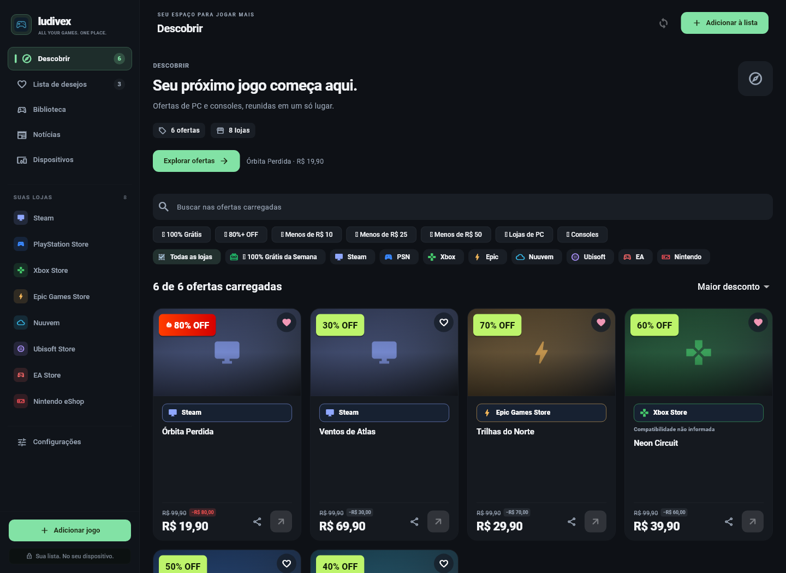

# Ludivex

Ludivex é um aplicativo Flutter para descobrir ofertas de jogos de PC e consoles, acompanhar preços e organizar uma biblioteca de jogos. Nos aplicativos desktop, também funciona como launcher para jogos locais e de contas Epic Games, GOG e Amazon Games.



## Recursos

| Tela | O que você pode fazer |
| --- | --- |
| **Descobrir** | Consultar ofertas regionais, jogos gratuitos e campanhas. Buscar por nome e filtrar por loja, desconto e compatibilidade Xbox. |
| **Biblioteca** | Reunir jogos locais e das contas conectadas. Buscar por nome, filtrar por loja, favoritos, recentes ou instalação, ordenar e alternar entre lista e grade. |
| **Lista de desejos** | Salvar ofertas ou cadastrar um jogo por busca ou link oficial. Definir metas de preço e consultar o histórico de avisos. |
| **Notícias** | Seguir jogos e consultar publicações da Steam. |
| **Dispositivos** | Catalogar controles e fones, buscar dispositivos Bluetooth compatíveis e consultar fontes de firmware. |
| **Configurações** | Selecionar região e lojas, testar APIs, ajustar atualização e alertas e escolher entre tema claro, escuro, OLED e automático. |

A barra superior do desktop inclui controles de janela e atalhos para lojas, sorteio de jogos e atualização de ofertas. Veja também as capturas da [Biblioteca](docs/screenshots/biblioteca.png) e da [Lista de desejos](docs/screenshots/lista-de-desejos.png). As imagens podem mostrar versões anteriores da interface.

## Começar a usar

### Descobrir e acompanhar preços

Escolha a região e as lojas em **Configurações**. O catálogo consulta fontes de Steam, Epic Games, Xbox, PlayStation, Nintendo, Nuuvem, Ubisoft e EA. A cobertura depende da loja, da região e da disponibilidade da fonte. Preços são exibidos na moeda da região consultada, conforme os dados retornados.

Na **Lista de desejos**, ative avisos para acompanhar novas mínimas ou defina uma meta para receber aviso ao atingir o preço desejado. O Ludivex consulta preços enquanto está aberto e ao voltar ao primeiro plano. Android, iOS, macOS e Windows têm suporte a notificações locais quando o sistema permite. O histórico pode ser consultado dentro do app. Com o aplicativo encerrado, o acompanhamento fica pausado.

Nas ofertas Xbox, o app usa os metadados da loja para identificar suporte a console, Windows e Xbox Play Anywhere. A indicação de Play Anywhere exige uma marcação explícita na fonte.

### Adicionar jogos locais

| Plataforma | Como importar e abrir |
| --- | --- |
| Windows | **Importar jogos instalados** consulta registros da Steam e Epic, atalhos de EA e Ubisoft e jogos Xbox registrados no sistema. O cadastro manual aceita executáveis, atalhos e links de abertura. |
| Linux e macOS | A importação consulta locais conhecidos da Steam. Também é possível cadastrar um executável ou link de abertura compatível. |
| Android | A Biblioteca detecta aplicativos classificados como jogos. Use **Revisar jogos encontrados** para escolher quais adicionar. A busca manual pode incluir aplicativos sem categoria de jogo. |
| iPhone e iPad | Adicione manualmente um link de abertura oferecido pelo jogo. |
| Web | Ofertas, lista de desejos e configurações. A biblioteca de jogos e a execução local estão disponíveis nos aplicativos nativos. |

No desktop, confirme a busca e, se necessário, informe uma pasta adicional da Steam. Depois, escolha quais resultados entram na Biblioteca. Cadastros manuais podem ser editados pelos detalhes do jogo.

### Conectar lojas no desktop

Abra **Biblioteca → Lojas e compatibilidade** e selecione uma loja. Instale o executável correspondente e coloque-o no PATH ou informe seu caminho na tela.

| Loja | Backend |
| --- | --- |
| Epic Games | [Legendary](https://github.com/legendary-gl/legendary) |
| GOG | [gogdl](https://github.com/Heroic-Games-Launcher/heroic-gogdl) |
| Amazon Games | [Nile](https://github.com/imLinguin/nile) |

1. Escolha **Entrar** e autentique-se na página da loja dentro do Ludivex. Ao concluir, o app fecha a página e sincroniza os jogos da conta automaticamente. Use **Carregar jogos** para reaproveitar uma sessão existente.
2. Escolha **Instalar** para baixar um jogo adquirido. O aplicativo adiciona a instalação à Biblioteca depois de confirmá-la. Use **Adicionar** quando uma instalação reconhecida já estiver disponível.
3. Volte à **Biblioteca** para jogar. Use **Atualizar jogos das contas** para consultar novamente os catálogos das lojas.

A integração usa os mesmos backends do [Heroic Games Launcher](https://github.com/Heroic-Games-Launcher/HeroicGamesLauncher). Os executáveis são dependências externas. Jogos e versões disponíveis variam por conta, sistema e backend.

### Configurar Wine ou Proton no Linux

Em **Lojas e compatibilidade**, selecione **Wine** ou **Proton via umu**. Informe o executável, um prefixo opcional e, para fixar uma versão do Proton, o caminho absoluto da pasta que contém o arquivo `proton`. Com a pasta em branco, o [umu-run](https://github.com/Open-Wine-Components/umu-launcher) resolve o GE-Proton.

Use **Verificar runtime** para verificar a configuração e **Salvar configurações** para aplicá-la. A escolha é global e vale para os jogos das lojas iniciados pelo Ludivex e para executáveis locais `.exe`.

### Consultar dispositivos e firmware

Em **Dispositivos**, use **Buscar dispositivos** ou cadastre um modelo manualmente. A leitura depende da plataforma, das permissões e dos dados expostos pelo aparelho. No iOS, a busca se limita a dispositivos BLE acessíveis e à saída de áudio Bluetooth em uso. Bateria e firmware aparecem quando o sistema consegue ler essas informações.

No Windows, o Ludivex também lê o nível de bateria de controles e fones sem fio compatíveis com XInput. A tela **Dispositivos** consulta os dados ao abrir e a cada minuto enquanto estiver ativa.

No Linux, a tela consulta o BlueZ e as baterias HID que o kernel publica para periféricos USB e Bluetooth. No Android, a atualização automática começa após a autorização de Bluetooth, e **Ler dados Bluetooth** consulta o serviço de bateria de acessórios BLE pareados. No iOS e no macOS, busque o periférico BLE e use **Ler dados Bluetooth** para consultar a carga que ele expõe. A saída de áudio em uso no iOS e os aparelhos Bluetooth clássicos listados no macOS podem aparecer sem porcentagem.

**Verificar atualizações** consulta fontes públicas para modelos compatíveis e indica o caminho oficial quando a verificação depende de uma ferramenta do fabricante. A instalação de firmware é feita pelo software do fabricante.

## Desenvolver

O projeto exige **Flutter 3.47 ou superior** e **Dart 3.13 até antes do Dart 4**. Configure a toolchain do sistema que deseja compilar e confira o ambiente com o Flutter.

```sh
flutter doctor -v
flutter pub get
flutter devices
flutter run -d windows
```

Troque `windows` por `linux`, `macos` ou pelo identificador listado em `flutter devices`. Builds desktop usam a toolchain do sistema correspondente. No Windows, o Flutter precisa de suporte a links simbólicos para configurar plugins. No Linux, o CI usa Clang, CMake, Ninja, pkg-config, GTK 3 e WebKitGTK 4.1. O login integrado usa WebView2 no Windows, WKWebView no macOS e WebKitGTK 4.1 no Linux.

```sh
flutter analyze
flutter build windows --release
flutter build linux --release
flutter build macos --release
flutter build apk --release
flutter build ios --release --no-codesign
```

A [configuração de CI](.github/workflows/main.yml) mostra a preparação e o empacotamento de cada plataforma. A assinatura para distribuição iOS precisa ser configurada no Xcode.

| Caminho | Responsabilidade |
| --- | --- |
| [lib/main.dart](lib/main.dart) e [lib/src/app.dart](lib/src/app.dart) | Inicialização, tema e navegação. |
| [lib/src/views](lib/src/views) | Telas e componentes Flutter. |
| [lib/src/models](lib/src/models) | Modelos de jogos, ofertas, dispositivos e regiões. |
| [lib/src/data](lib/src/data) | Adaptadores dos catálogos de lojas. |
| [lib/src/services](lib/src/services) | Biblioteca local, backends de lojas, persistência, preços e notificações. |
| [windows](windows), [linux](linux), [macos](macos), [android](android) e [ios](ios) | Runners e integrações nativas. |

## APIs alternativas de ofertas

Configure uma URL HTTPS por loja em **Configurações → Lojas e APIs**. O cliente faz `GET` com o código da região em `region` e envia `q` para buscas, `cursor` para paginação ou `campaignId` para uma campanha específica, conforme a operação.

```json
{
  "deals": [
    {
      "id": "produto-123",
      "title": "Nome do jogo",
      "currentPrice": 49.90,
      "originalPrice": 99.90,
      "currency": "BRL",
      "storeUrl": "https://example.com/jogos/produto-123"
    }
  ],
  "nextCursor": "pagina-2"
}
```

Cada oferta deve informar `id`, `title`, `currentPrice` e `originalPrice`. Informe preços como números na moeda da região consultada. Sem `currency`, o app usa a moeda padrão da região. A resposta também pode incluir `total` e `campaigns`. O [adaptador de fontes](lib/src/data/store_providers.dart) e os [modelos](lib/src/models) descrevem os campos aceitos.

## Dados e privacidade

A biblioteca local, os favoritos, o histórico de inicialização, a lista de desejos e as preferências ficam no dispositivo. O catálogo das contas conectadas é atualizado pelos backends das lojas. As sessões são mantidas por Legendary, gogdl e Nile. O Ludivex usa a rede para consultar catálogos, preços, notícias, firmware e serviços das lojas conectadas. Os registros locais de dispositivos Bluetooth não são enviados aos fabricantes nas consultas de firmware.
